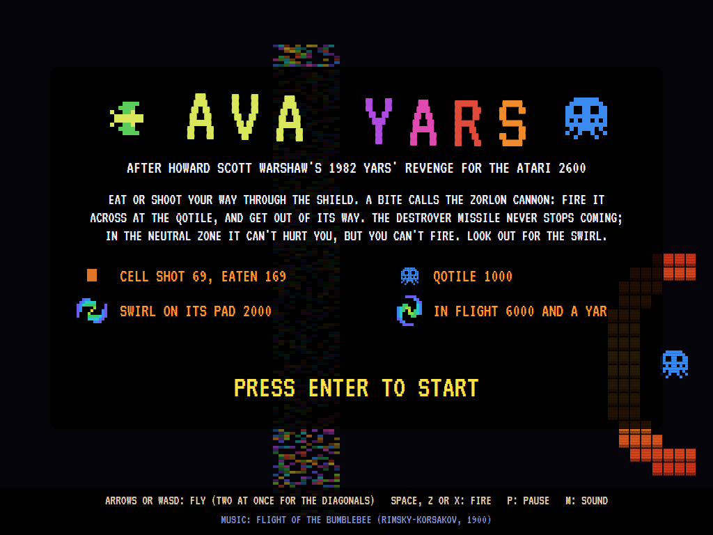
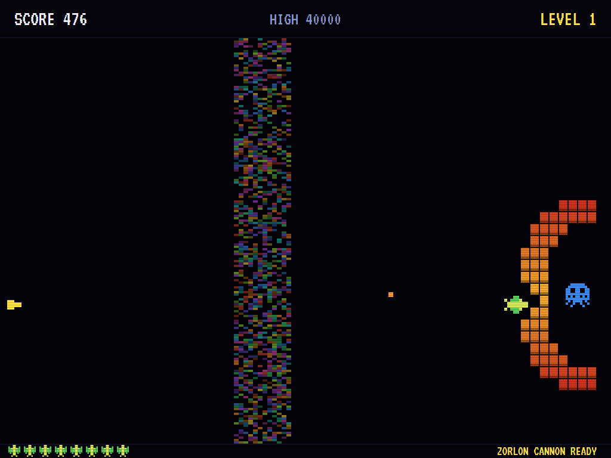
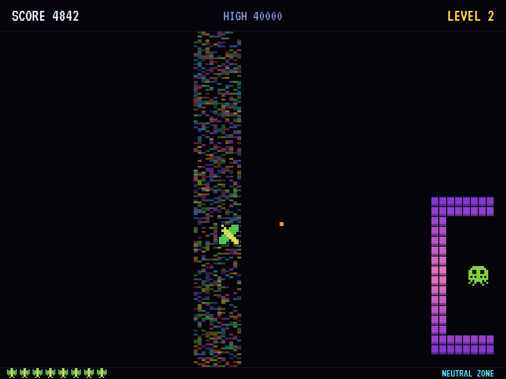
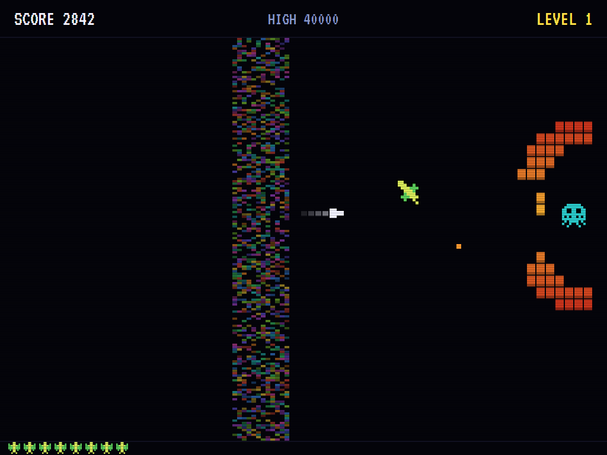
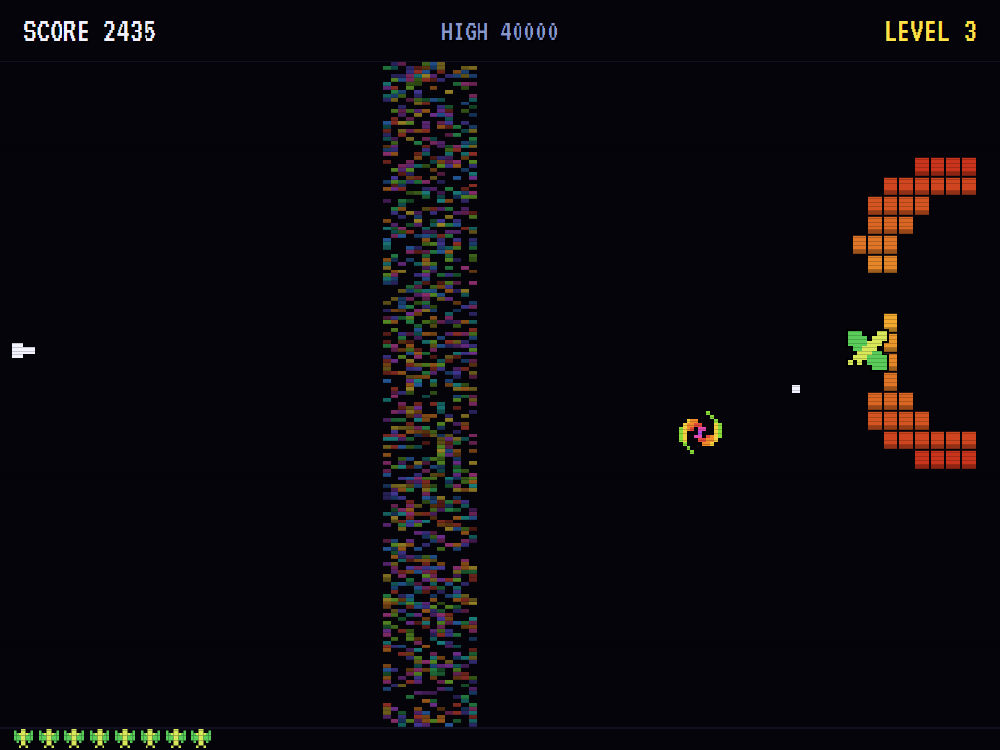
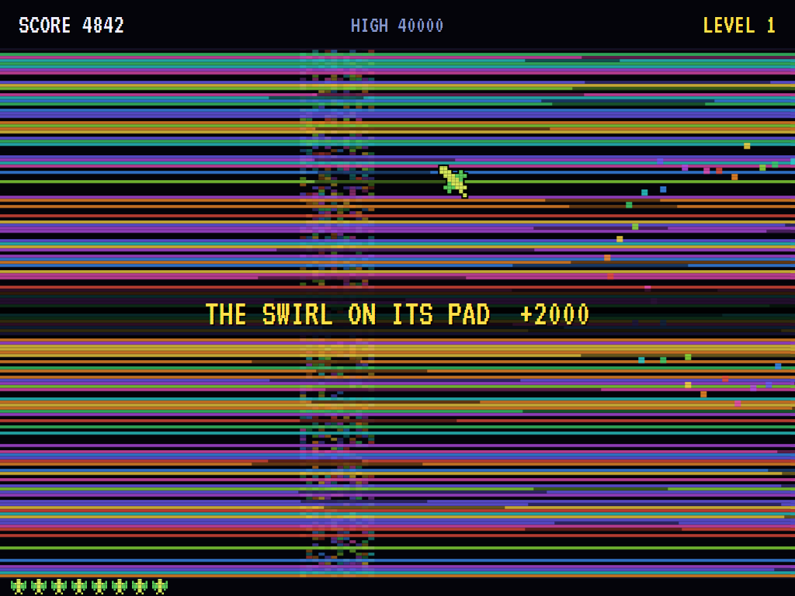
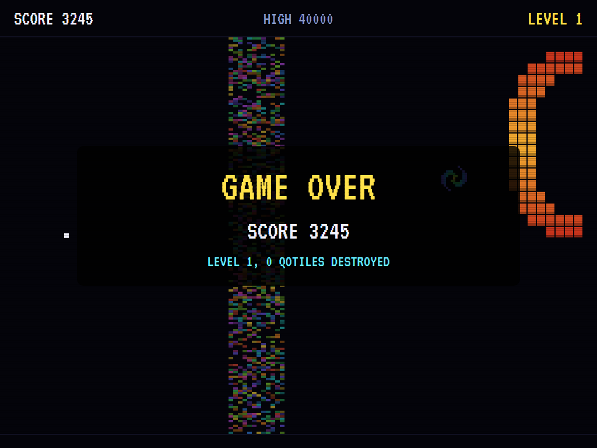
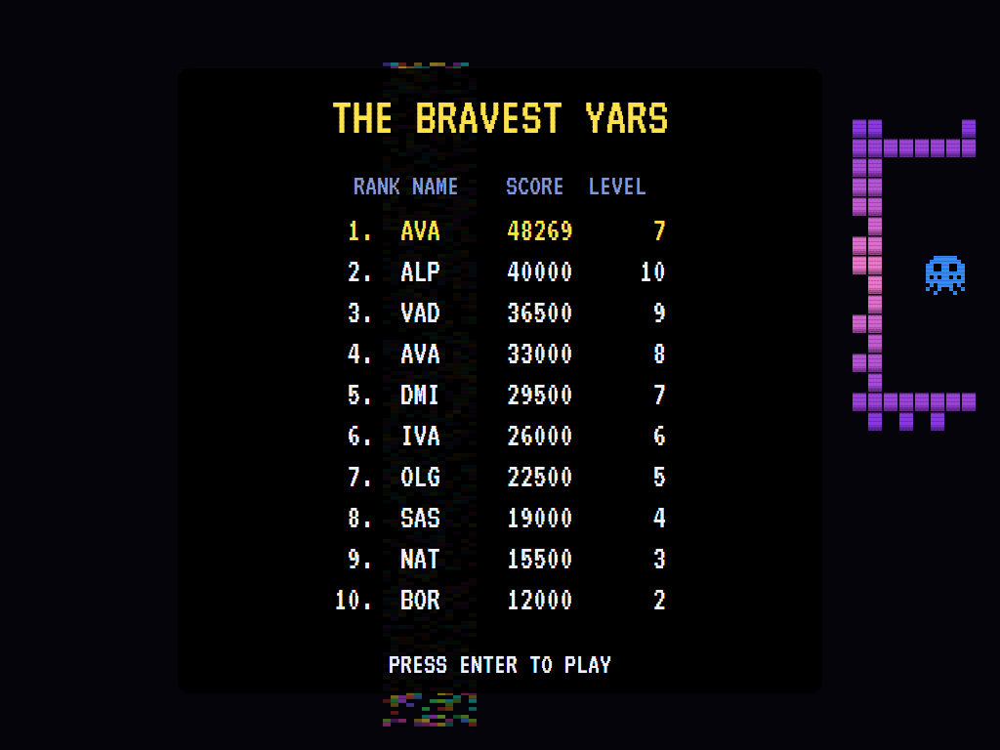

# AVA Yars

[](https://github.com/Harlock123/AVAYars/actions/workflows/build.yml)

A shooter in the style of Howard Scott Warshaw's 1982 Atari 2600 game **Yars' Revenge**, built with .NET 10 and
Avalonia UI. You are the Yar, a fly-like creature. On the right, behind a shield of cells, sits the Qotile. Eat or
shoot your way through the shield; a bite calls up the Zorlon Cannon on the left edge, which follows you up and
down. Fire it across at the Qotile, and get out of its way, because it can hit you too. The Destroyer Missile never
stops coming after you, except in the Neutral Zone, where you can't fire. And now and then the Qotile turns into the
Swirl and flies at you.

## Features

- **The playfield wraps from top to bottom:** fly off the top and you come in at the bottom. The missile and the
  Swirl don't follow you round, so the wrap is a way out.
- **Two shields, a level each in turn.** On odd levels a thick arch of cells round the Qotile; on even levels a band
  whose cells run round it like a conveyor, carrying the holes you make away with them. Either way the shield and
  the Qotile go up and down together.
- **Eating and shooting:** fly into the shield and the Yar takes a bite of a cell and is pushed back; or fire an
  energy missile the way you face, one at a time.
- **The Zorlon Cannon:** a bite, or touching the Qotile, calls it up. While it's there the fire button fires it,
  straight across at the height you were. A cell in the way takes the blast, so chew a tunnel first; and move, or
  it hits you.
- **The Neutral Zone:** the shimmering band of colour across the middle. The Destroyer Missile can't touch you
  there, but you can't fire, and the Swirl can still get you.
- **The Swirl:** the Qotile spins on its pad, then launches straight at you. From the third level it steers after
  you in flight.
- **The explosion:** destroy the Qotile and the screen shakes and tears into stripes of colour while you fly on;
  then the next level, with the other shield, and everything quicker.
- **Scoring, as in the original:** a cell shot 69, a cell eaten 169, the Qotile 1,000, the Swirl on its pad 2,000,
  and the Swirl in flight 6,000 and an extra Yar. Four Yars to start.
- **The attract mode** shows the computer player at work. It chews a tunnel through the shield in front of the
  Qotile, falls back to the left, lines the cannon up with where the Qotile will be, and fires, dodging its own
  shot. Every few moments it tries each of the nine ways it could fly on a copy of the world, and it only fires when
  a copy shows the shot going home. With the missile close behind it sometimes rests in the Neutral Zone.

## Screenshots

| The title | Chewing the shield | The Neutral Zone |
|:---------:|:------------------:|:----------------:|
|  |  |  |
| | A tunnel, and the cannon called. | Safe from the missile, but no firing. |

| The Zorlon Cannon | The Swirl | The Qotile destroyed |
|:-----------------:|:---------:|:--------------------:|
|  |  |  |
| Through the tunnel. | Launched at the Yar. | The Swirl, in flight. |

| Game over | The bravest Yars |
|:---------:|:----------------:|
|  |  |

The screenshots are made by the tests, which play the game in a real (headless) window; see
[Tests](#tests).

## Download and run

Ready-to-run builds for Windows, macOS and Linux, on both Intel/AMD and ARM, are on the
[Releases page](https://github.com/Harlock123/AVAYars/releases/tag/latest). **Latest build** is
rebuilt on every push to `main`. Each download is one self-contained executable: no .NET install is
needed.

| Platform | Archive |
|---|---|
| Windows | `AVAYars-win-x64.zip`, `AVAYars-win-x86.zip`, `AVAYars-win-arm64.zip` |
| macOS | `AVAYars-osx-arm64.tar.gz` (Apple silicon), `AVAYars-osx-x64.tar.gz` (Intel) |
| Linux | `AVAYars-linux-x64.tar.gz`, `AVAYars-linux-arm64.tar.gz`, `AVAYars-linux-arm.tar.gz` |

```bash
tar -xzf AVAYars-linux-x64.tar.gz     # or linux-arm64, linux-arm, osx-arm64, osx-x64
./AVAYars
```

On Windows, unzip and run `AVAYars.exe`. On macOS, if Gatekeeper refuses to open it, run
`xattr -d com.apple.quarantine AVAYars` once. Run with `--no-audio` for silence.

**Sound** comes through OpenAL Soft, built in for every platform. In a virtual machine the game
detects it and uses a larger audio buffer, so the sound doesn't break up.

**Gamepads** use SDL2, which is bundled for Windows, macOS and Intel/AMD Linux. ARM Linux builds need it
installed; without it the keyboard still works:

```bash
sudo apt install libsdl2-dev            # Debian / Ubuntu / Raspberry Pi OS
sudo pacman -S --needed sdl2-compat     # Arch / Omarchy
```

## Controls

| Action | Keyboard | Gamepad |
|---|---|---|
| Start | Enter or 1 | Start |
| Fly | Arrows or WASD; two at once for the diagonals | Left stick / D-pad |
| Fire (the energy missile, or the Zorlon Cannon when it's there) | Space, Z, X or Ctrl | A or B |
| Pause | P or Esc | Start |
| Sound on/off | M | |
| Screenshot | Ctrl+S (to your Pictures folder) | |

Hold fire for a stream of energy missiles; the cannon takes a fresh press. On the high-score table, type your
initials, or use up/down and Space, then Enter.

## Tests

```bash
dotnet test AVAYars.slnx
```

The game runs in fixed 60 Hz steps, so it plays the same at any frame rate. Everything that changes lives in
one world that can be copied. The tests check:

- **The shields:** the arch and the band taking turns, the Qotile's pocket, the band's lanes taking in every cell;
  the shield going up and down with the Qotile, and the band carrying a gap round.
- **The Yar:** eight ways, wrapping from top to bottom but stopped at the sides; a bite for 169, pushed back, and
  the cannon called; touching the Qotile calling it too; shots for 69, one at a time, the way it faces, and none
  in the Neutral Zone.
- **The Zorlon Cannon:** following the Yar, fired by a press, straight across; stopped by a cell; through a tunnel
  to the Qotile for 1,000, the Swirl on its pad for 2,000, in flight for 6,000 and a Yar; hitting the Yar.
- **The missile and the Swirl:** the missile homing in, harmless in the Neutral Zone, never following round the
  wrap; the Swirl spinning on its pad, launched at the Yar, hitting it even in the zone, going home when it misses,
  and steering from the third level; everything quicker each level.
- **The computer player** destroying the Qotile on the first two levels; flying straight at the shield getting
  hit.
- **The game:** four Yars, the extra one, the end and a high score; a new Yar on the left with the shield as it
  was; the explosion and the next level; the Yar's buzz turning to the zone's hum; the demonstration and high
  scores; a copied world going on as the original; the keys, up flying up the screen.

`tests/AVAYars.Tests/PilotProbe.cs` reports how the computer player gets on, for tuning (`YARS_PROBE=1`). It gets
through twelve levels in under four minutes for the loss of one Yar, to the steering Swirl. `YARS_PROBE=lazy` flies straight at the Qotile firing, and is hit twelve times in under
a minute and a half.

The screenshot tests draw the real screen in a headless window. To refresh the README's pictures:

```bash
YARS_SHOTS=$PWD/Images dotnet test tests/AVAYars.Tests --filter ScreenshotTests
```

## Building

```bash
dotnet build AVAYars.slnx
dotnet run --project src/AVAYars
```

Needs the .NET 10 SDK. The sounds and music are made by `tools/make_sounds.py` (standard-library Python):
`python3 tools/make_sounds.py` rewrites `src/AVAYars/Sounds`.

## Project structure

```
AVAYars/
├── AVAYars.slnx
├── src/AVAYars/
│   ├── Engine/
│   │   ├── GameEngine.cs        # States, levels, lives, the explosion, the demonstration
│   │   ├── Sim.cs               # Flying and wrapping, eating and shooting, the cannon, the missile, the Swirl, the shield
│   │   ├── World.cs             # The field, the shields' shapes, and everything that changes, kept so it can be copied
│   │   ├── Pilot.cs             # The computer player (the demonstration, and the tests)
│   │   ├── HighScoreTable.cs, InitialsEntry.cs
│   │   ├── InputHandler.cs, ControllerManager.cs  # Keys and an SDL2 gamepad
│   │   └── SoundManager.cs      # Effects, loops and music through OpenAL
│   ├── Audio/                   # The OpenAL engine (from the author's AVABand)
│   ├── Views/GameCanvas*.cs     # The Yar, the Qotile, the shield, the Neutral Zone, the explosion, the title
│   └── Sounds/                  # The synthesised effects, loops and music
├── tests/AVAYars.Tests/         # Gameplay and screenshot tests
├── tools/make_sounds.py
└── Images/                      # Screenshots
```

## About and licence

AVA Yars © 2026 Lonnie Watson, under the [MIT License](LICENSE).

*Yars' Revenge* © 1982 Atari; the names *Yars' Revenge*, *Yar*, *Qotile* and *Zorlon Cannon* belong to their
current owner. AVA Yars is an independent, unofficial game in its style. Its graphics, sounds and code are its own;
nothing is taken from the original game's program, graphics or sound. It is not affiliated with or endorsed by any
rights holder. The title music is the *Flight of the Bumblebee* by Nikolai Rimsky-Korsakov (1900), arranged here for
two chip voices; the other sounds are the game's own.
